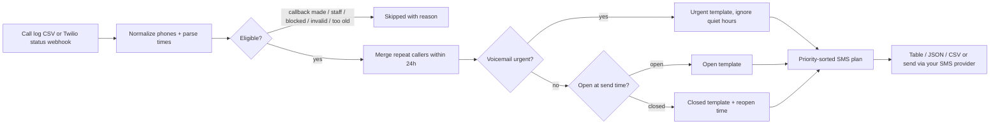

# Missed Call Text Back: open-source, self-hosted Python tool for service businesses

   

**Missed Call Text Back is a free, open-source Python tool that reads your call log and plans an instant, polite SMS reply to every missed call, with quiet hours, duplicate-caller merging, urgent-voicemail priority and industry templates for HVAC, plumbing, roofing, clinics, salons and real estate.** It is built for small service businesses and the developers/agencies who serve them, runs offline with zero dependencies, and can optionally run as a Twilio-compatible webhook.

## Why / problem it solves

Service businesses miss calls while they are on a job, with a client, or asleep. A caller who gets voicemail often calls the next company. Paid "missed call text back" products solve this, but they come bundled in monthly CRM subscriptions. This repo is a small, readable, self-hosted alternative to the text-back feature of tools such as GoHighLevel, Podium or Emitrr: you keep your data, edit the templates, and only pay your SMS provider.

It answers three practical questions that most basic auto-reply scripts ignore:

1. **Who should get a text?** Skips callers you already called back, your own staff, blocked numbers, invalid numbers and stale calls.
2. **When should it go out?** Respects quiet hours, but lets genuinely urgent voicemails ("burst pipe", "no heat") through.
3. **What should it say?** Different wording when you are open, closed, or the caller sounds urgent, with an opt-out line.

## 2-minute Quickstart

```bash
git clone https://github.com/Waqas-Ai-Engineer/missed-call-text-back.git
cd missed-call-text-back
python mctb.py demo          # runs on bundled SAMPLE data, no keys needed
```

Plan from your own call log (CSV with `timestamp,caller,status`; optional `name,voicemail,direction`):

```bash
python mctb.py plan my_calls.csv -c example_config.json -f table
python mctb.py plan my_calls.csv -c example_config.json -f json   # for n8n / Zapier / scripts
python mctb.py plan my_calls.csv -c example_config.json -f csv    # paste into a sheet or SMS tool
```

Requires only Python 3.9+. Everything lives in one flat folder: `mctb.py` is the entry point.

## Demo output

Produced by running `python mctb.py demo` (all numbers and the business are fictional sample data; the revenue line is computed from the sample inputs, not a real result):

```text
(SAMPLE DATA - fictional numbers and business)

MISSED-CALL TEXT-BACK PLAN
==========================

 1. +15550100104  Dan  [URGENT]  calls=1  send=Thu 7:05 AM
    why: urgent keyword in voicemail
    sms (240 chars, 2 segment): Hi Dan, this is Sample Comfort HVAC. We got your message and it sounds urgent. Reply with your address and one line about the problem so we can prioritize you. If anyone is in danger, call your local emergency number. Reply STOP to opt out.

 2. +15550100101  Maria  [open-msg]  calls=2  send=Thu 8:00 AM
    why: missed during open hours; 2 calls merged
    sms (163 chars, 2 segment): Hi Maria, this is Sample Comfort HVAC. Sorry we missed your call! Heating, cooling or tune-up? Reply here and we will get right back to you. Reply STOP to opt out.

 3. +15550100102  (no name)  [open-msg]  calls=1  send=Thu 8:00 AM
    why: missed during open hours
    sms (157 chars, 1 segment): Hi, this is Sample Comfort HVAC. Sorry we missed your call! Heating, cooling or tune-up? Reply here and we will get right back to you. Reply STOP to opt out.

 4. +15550100106  Priya  [open-msg]  calls=1  send=Thu 8:00 AM
    why: missed during open hours
    sms (163 chars, 2 segment): Hi Priya, this is Sample Comfort HVAC. Sorry we missed your call! Heating, cooling or tune-up? Reply here and we will get right back to you. Reply STOP to opt out.

 5. +15550100105  (no name)  [open-msg]  calls=1  send=Thu 8:00 AM
    why: missed while closed
    sms (157 chars, 1 segment): Hi, this is Sample Comfort HVAC. Sorry we missed your call! Heating, cooling or tune-up? Reply here and we will get right back to you. Reply STOP to opt out.

 6. +15550100107  (no name)  [open-msg]  calls=1  send=Thu 8:00 AM
    why: missed while closed
    sms (157 chars, 1 segment): Hi, this is Sample Comfort HVAC. Sorry we missed your call! Heating, cooling or tune-up? Reply here and we will get right back to you. Reply STOP to opt out.

SUMMARY
  texts to send : 6 (urgent 1, closed-msg 1, repeat callers 1)
  skipped       : already_reached=1, do_not_text=1, duplicate_within_window=1, internal_number=1, invalid_number=1, too_old=1
  est. revenue  : 405  <- 6 texts x 15% assumed recovery x 450 avg job value (your inputs, not a measured result)
```

## Features

- Reads a plain CSV call log (flexible column names: `timestamp/time/date`, `caller/from/phone`, `status`).
- Normalizes phone numbers to E.164 and drops invalid ones.
- Merges repeat missed calls from the same caller inside a 24h window into one text (and bumps priority).
- Skips callers who were already reached by a callback within a configurable window.
- Business hours per weekday, quiet hours (overnight windows supported), automatic "we reopen Thu 8:00 AM" wording.
- Urgent keyword detection in voicemail transcripts with priority sorting and quiet-hours bypass (configurable).
- Do-not-text list, internal-number list, max-age filter.
- Built-in templates for general, HVAC, plumbing, roofing, clinic, salon and real-estate businesses (`python mctb.py templates`).
- SMS segment counting and an automatic "Reply STOP to opt out." line.
- Optional webhook server: dry-run by default, real sending only with `--send` plus Twilio environment variables, with `X-Twilio-Signature` verification.
- Table, JSON and CSV output. Zero dependencies. 15 unit tests.

## How it works



```text
calls.csv --> parse --> filter --> merge --> classify --> schedule --> render --> plan (table|json|csv)
```

## Use cases by industry

- **HVAC and plumbing:** emergency voicemails ("no heat", "burst pipe") jump to the top of the list.
- **Roofing and contractors:** after-hours storm-season calls get a "we reopen Monday 8:00 AM, send us your address" reply.
- **Clinics and dental offices:** polite "reply to book or change an appointment" wording that avoids collecting health details by text.
- **Salons and barbers:** "we may be with a client" tone, ask for service and day.
- **Real estate:** buyer/seller/listing qualifying question.
- **Agencies and freelancers:** run it against a client's call export as a quick audit, or wire the JSON output into n8n, Zapier or Make.

## Examples and templates (flat layout, copy any file)

- `example_calls.csv` - fictional sample call log.
- `example_config.json` - copy and edit: business name, industry, hours, UTC offset, quiet hours, block lists, booking link.
- `mctb_templates.py` - all SMS wording, one dictionary per industry.

## Webhook mode (optional)

```bash
python mctb.py serve -c example_config.json --port 8080        # dry-run: shows what it would send
export TWILIO_ACCOUNT_SID=... TWILIO_AUTH_TOKEN=... TWILIO_FROM=+1... MCTB_PUBLIC_URL=https://your.host/
python mctb.py serve -c example_config.json --send            # really sends
```

Point your Twilio number's call status callback at the server (POST). Duplicate suppression is kept in memory, so use a persistent store before running this in production. See [COMPLIANCE.md](COMPLIANCE.md) before sending real texts.

## FAQ

### What is missed call text back?
It is an automatic SMS sent to a caller whose call you could not answer, so the lead can reply instead of calling a competitor.

### Is this missed call text back tool free?
Yes. The code is MIT licensed and has no dependencies. If you send real texts you pay your SMS provider (for example Twilio) their normal per-message fees.

### How do I send a text automatically after a missed call?
Run `serve --send` as a webhook behind your provider's call status callback, or run `plan -f json` on a schedule and feed the result to n8n, Zapier or Make.

### Is this an alternative to GoHighLevel, Podium or Emitrr?
It is a small self-hosted alternative to their missed-call-text-back feature only. It does not include a CRM, inbox, calendar or two-way chat UI.

### Does it work outside the US?
Planning works with any country: set `default_country_code` and `utc_offset_hours`. SMS delivery rules vary by country, so check your provider.

### Is it legal to text people who called me?
Rules differ by country and by your consent practices (for example TCPA and carrier registration in the US). The tool adds an opt-out line and supports a do-not-text list, but this is not legal advice. See COMPLIANCE.md.

### Can I use my own wording?
Yes. Edit `mctb_templates.py`; placeholders are `{greeting}`, `{business}`, `{reopens}` and `{book}`.

### Does it store or send my data anywhere?
Planning is fully offline. Only `serve --send` talks to the network, and only to the Twilio API.

## Roadmap

- [ ] Importable n8n workflow example
- [ ] Two-way reply handling (STOP/START keywords)
- [ ] Persistent dedupe store (SQLite) for webhook mode
- [ ] More provider adapters (Vonage, MessageBird)
- [ ] Per-industry follow-up sequences

## Contributing

Issues and pull requests are welcome. See [CONTRIBUTING.md](CONTRIBUTING.md). Run the tests with `python -m unittest test_core`.

## Hire me / Need this built?

I am Muhammad Waqas, an AI Agents & Business Automation developer. If you want this wired into your phone system, CRM, WhatsApp or n8n/Make setup, contact me via my GitHub profile: https://github.com/Waqas-Ai-Engineer

## License

MIT, see [LICENSE](LICENSE).

---

If this helped, please star the repo. Follow [@Waqas-Ai-Engineer](https://github.com/Waqas-Ai-Engineer) for daily open-source automation tools.
